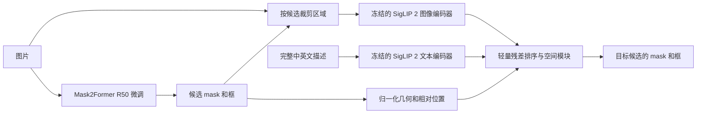

# 自然语言引导的服饰实例选择与分割

**图片 + 一句中英文描述 → 描述所指的单个整件服饰的 mask 和 bounding box。**

课程：COMP 4471 / ELEC 4240。三人项目。当前方案版本：`2026-11-05`。

> [1000→5000步有界续训](docs/handoffs/segmentation/resume5000_dev_ap_20261113.md)已完成：完整250图dev在2000/3000/5000步的mask AP为46.0636/50.5603/48.8844，选择第3000步（mask AP=50.5603）。六项恢复状态与父checkpoint一致，新增4000步、0跳步，GPU已释放；仅补新增预算扩展CPU测试，没有重复smoke或启动20k完整S0/test。旧LSJ污染权重继续隔离。

## 团队与 Codex 开工入口

暂定职责沿用现有分工，成员简称已于 2026-11-11 确认：**lcy 负责分割与候选，wyz（A）负责图文匹配，wkq（B）负责数据与评估**。GitHub 账号绑定和最新整组分支/PR 证据见 [状态表](docs/status.md)。AutoDL 实例已创建，发起人的 SSH 与基础 PyTorch/CUDA 识别已核验；分割/图文环境已有短检查证据，最新资源快照见 [本轮交接](docs/handoffs/segmentation/dev_ap_20261112.md)。

每次开工先查 [当前进度与下一步](docs/status.md)，再读 [AGENTS.md](AGENTS.md) 、[详细分工与协作说明](docs/team_workflow.md) 和 [完整工作流程](docs/workflow.md)，再读自己的任务卡：[分割](docs/roles/segmentation.md)、[图文](docs/roles/grounding.md)、[数据与评估](docs/roles/data_eval.md)。任务卡包含第一批工作、接口、验收和可直接交给 Codex 的开工说明。三人共同标注并交叉复核，GT 语言基线无需等待分割训练。

## 项目目的

研究模型能否在多个服饰候选中，利用类别、外观和位置正确理解用户所指的实例，例如“右边的红色包”。重点分析现成图文表示、少量领域监督与空间信息各自的作用，并区分候选漏检、语言选错和掩膜边界误差。实习经验仅提供选题背景，旧 PRD 的指定技术栈、准确率与吞吐量门槛不作为课程约束。

## 当前方案

- **主数据：**Fashionpedia，保留八类整件映射；八类是统计范围，不是查询词汇表。保留源细类，排除部件标注。
- **分割：**公开预训练 Mask2Former-R50，在 Fashionpedia 上微调；所有内部语言方法共享候选。
- **图文匹配：**首选 `google/siglip2-base-patch16-224`，冻结双编码器，先做零样本基线，再训练外观残差排序与文本条件空间模块。
- **核心比较：**B0 类别/位置规则、B1 SigLIP 2 零样本、B2 零样本加方位规则、M1 外观适配、M2 外观适配加空间模块、E1 外部文本分割系统。
- **外部对照：**优先 SAM 3；访问或环境不适用时以 Grounding DINO + SAM 2 替代，二选一，开发集阶段登记版本。
- **推荐扩展：**优先 X3 背景干扰对照，整理已有语言挑战测试；演示先做候选评分可视化，再选一轮交互纠正。多目标、无目标拒绝、局部编辑、否定理解及原有其他对照保留为可选项，详见[扩展计划](docs/extension_plan.md)。全部为待实现/待验证规划，核心仍为单目标。

SigLIP 2 更适合作为起点是研究选择，不是已测得的优势。主流程属于候选实例选择：语言模块无法恢复候选中缺失的目标，也不根据文字生成新的 mask。

## 阅读顺序

| 内容 | 作用 |
| --- | --- |
| [项目讲解](docs/project_guide.md) | 目的、范围、研究问题和推进顺序 |
| [本次方案调整](docs/revision_20261105.md) | 相对已提交 proposal 的保留、替换与优先级变化 |
| [技术设计](docs/technical_design.md) | 模型、分数、损失、候选解码和起始参数 |
| [数据协议](docs/data_protocol.md) | 原始类别映射、划分、双语查询和人工复核 |
| [实验计划](docs/experiment_plan.md) | 强基线、公平比较、指标、统计和进度 |
| [可选扩展计划](docs/extension_plan.md) | 背景干扰、语言挑战、交互演示与可靠性扩展的范围及验收方式 |
| [当前状态](docs/status.md) | 各阶段真实状态、每人下一步、阻塞与证据入口 |
| [文件交接契约](docs/artifact_contract.md) | schema 3、manifest/候选/预测、完整合成示例 |
| [共享规则解析](docs/rule_parser_contract.md) | B0/B2 共用词表与解析，分别评分 |
| [运行记录规范](docs/run_records.md) | 计划与 run 区分、候选条件、指标和元信息 |
| [实现规范](docs/implementation_spec.md) | 待开发模块、接口、缓存和检查要求 |
| [协作说明](docs/team_workflow.md) | 暂定职责、文件归属、交接契约、单卡排队与 PR 规则 |
| [完整工作流程](docs/workflow.md) | P0–P10 的先后依赖、并行任务、交付条件、最终测试与归档 |
| [课程要求](docs/course_requirements.md) | 历史整理的提交要求及日期复核边界 |
| [已提交 proposal 正文](docs/proposal_submitted.md) | 用户提供的提交版正文转录，保留历史方案 |
| [早期 proposal 草稿](docs/proposal.md) | 历史草稿，不代表已提交内容或当前设计 |

## 数据与实验状态

[training_plan.json](configs/training_plan.json) 定义规划值，[project.json](configs/project.json) 记录范围与状态；[registry.csv](experiments/registry.csv) 保留计划与历史工程运行，新增本轮限定 train 和两条真实 dev 评价。仅两条真实 dev 行填写 mask AP，旧工程行保持空白。旧实验登记保存在 [归档表](experiments/archive/registry_20261004.csv)，仅供追溯。

分割既有工程验证见 [200-update 交接](docs/handoffs/segmentation/stability_200_20261112.md)，环境见 [分割环境入口](envs/segmentation/README.md)，训练入口与恢复命令见 [TRAINING.md](envs/segmentation/TRAINING.md)。[真实 dev AP/选择](docs/handoffs/segmentation/real_dev_ap_20261112.md)已完成；完整长训练仍未执行。

已提供仅使用 Python 标准库的 `python scripts/check_contract_examples.py`，验证合成交接夹具；它不实现数据转换、训练或评价。完整示例和命令见 [examples](examples/README.md)。

Git 跟踪的数据、模型和输出目录保留占位；真实接口包存放于共享数据盘；reviewed_v1 已有 34 条 accepted 训练查询，正式 dev/test 语言集尚未冻结。查询与预测示例均带 `illustrative_only`，不计入标注量或结果。原始数据、权重、缓存与私有凭据不上传 GitHub；报告必须引用公开模型与实现，并只报告本次课程实际产生的结果。

## 下一步

按[最新状态](docs/status.md)推进：分割 train/dev 已按用户人工复核确认固定，lcy 已修复训练增广补边，下一步从已校验COCO重新开始有界学习实验，不能续训旧污染权重；wyz 已完成同包 B0/B1/B2 与 M1 弱试训，继续 M2 和正式可比训练准备；wkq 推进语言 dev 审核及生产方记录归档。当前不启动完整长训练，不重复已通过的 smoke，扩展暂不开展。

沿用现有课程记录：Milestone 为 2026-11-06，Final report 为 2026-12-05，均为香港时间 23:59；2026-11-05 课程页面请求返回登录限制，提交前以 Canvas 最新通知为准。
