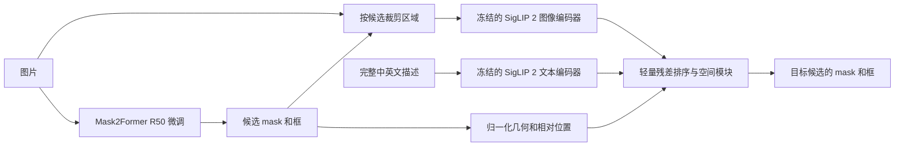

# 自然语言引导的服饰实例选择与分割

当前交付（2026-11-18）：[50k＋0.3候选接入说明](docs/handoffs/segmentation/current_candidates.md) **ready_for_downstream_development**。完整dev250的1279个候选及642条查询快照已固定，机器索引和交接说明同步到服务器共享目录；wyz/wkq可立即更新各自候选输入，不必等待分割继续优化。新候选区域特征使用新hash键，相同文本/语言/编码器的文本特征可复用。接收方本人运行与评价未代签；本轮仅交接，0训练/推理/smoke。

前次完成（2026-11-18）：[50k离线残余错误分析](docs/handoffs/segmentation/u50000_residual_diagnosis_20261118.md) **completed**。复用现有AP预测与候选缓存，1008 GT全量分析；固定0.3小目标88/138匹配.5、40/138匹配.75，剩余21低分过滤、24局部几何、3仅异类达标、2无明显重叠。袜6/17、腰带30/47；弱图重采样A/B仅为后续建议；当前优先交接固定候选，未准备或启动新训练。仅CPU诊断与8例看图，0推理/训练/AP重算/smoke；50k＋0.3候选保持。

前次完成（2026-11-18）：[50k完整dev候选与固定阈值](docs/handoffs/segmentation/u50000_candidates_dev250_20261118.md) **completed**。仅一次250图候选推理，阈值前23871个非空候选；三档0.3/0.5/0.7全dev候选1279/1155/1062，当前642条accepted开发查询覆盖602/592/580，选定 **50k＋0.3，93.7695%**。总448.390秒/900秒硬限，3496个新候选裁剪通过；0训练/0AP重评/0smoke/0排序，GPU与锁已释放。新包已发布，旧18k保留；队友本人接收未代签。

前次完成（11月18日核查）：[10k训练与最终权重](docs/handoffs/segmentation/tenk_completion_20261118.md)已于11月17日23:30正常结束，10epoch/50000成功updates，总6小时6分26秒。2/4/6/8/10epoch完整dev AP为63.2350/66.3351/66.7770/68.5897/**69.0313**；最终选50k，较旧C5k AP+4.3356、AP_small+12.0599、AP75+4.9937。GPU与锁已释放，无自动延长/重启；本轮仅复用结果，0新增训练/推理/smoke。旧18k候选未替换，[最终权重路径及SHA256](docs/handoffs/segmentation/evidence/tenk_completion_20261118/final_checkpoint.json)已固定。

启动前准备：[10k有界分段执行准备](docs/handoffs/segmentation/tenk_execution_preparation_20261117.md)已完成（代码`6b5fc8c`）。C5k20k模型参数热启动、最多10等效epoch、每2epoch完整dev、连续3次未改善早停及与缓存基线选权重已接线；拟总8小时/每段2小时，未授权启动。15项新增CPU执行逻辑验证通过；训练/推理/旧smoke均为0，所有启动标记仍关闭。原增强诊断已决定不启用定向裁剪，复用此前结果。

历史完整数据[接收需求](https://github.com/rickyliuchunyu/comp4471-fashion-grounding/blob/0b8a0a88119d4e68f9386e11b88b94d968e0d8d2/docs/handoffs/segmentation/full_fashionpedia_intake_20261117.md)及[1–2epoch提案](https://github.com/rickyliuchunyu/comp4471-fashion-grounding/blob/0b8a0a88119d4e68f9386e11b88b94d968e0d8d2/docs/handoffs/segmentation/full_data_short_plan_20261117.md)保留在独立分支，未训练；已不作为当前10k优化的前置依赖。

**图片 + 一句中英文描述 → 描述所指的单个整件服饰的 mask 和 bounding box。**

课程：COMP 4471 / ELEC 4240。三人项目。当前方案版本：`2026-11-05`。

最新（2026-11-17）：[5k/10k受控对照](docs/handoffs/segmentation/expansion_control_20261117.md)仅C5k完成，20k权重完整dev AP **64.6957**，高于历史B20k 0.9027点。D10k在159步主动中断，无checkpoint或AP，扩充收益尚未验证。GPU已释放，不自动重启/延长；旧候选与B1交付保留。

> [正式S0](docs/handoffs/segmentation/s0_recovery20000_20261115.md)选择18k AP=63.5792，dev候选阈值固定0.3。lcy的[最小B1联调](docs/handoffs/segmentation/u18000_b1_pipeline_20261115.md)已完成：当前116图/290查询均输出原mask/框，选对178/290=61.38%，Success@0.5=73.10%。22.572秒，无新分割推理/训练/smoke；调用wyz原B1，不替代其排序研究及wkq全组评价。

上一轮：[min_scale 0.1→0.5 单因素对照](docs/handoffs/segmentation/min_scale_trial_20261115.md)已完成，同一18k→20k、一次完整dev250，选中 **B20k AP=63.7930**（比复用A +0.2334、比旧最佳 +0.2138）。总15分58秒/45分钟硬限，未延长/重启/重复smoke。AP_small较旧最佳仅+0.0136、AP75略低，小目标/边界未明显改善。现有候选和B1交付仍对应18k＋0.3，本轮仅选新权重。此前[分布分析](docs/handoffs/segmentation/train5000_distribution_20261115.md)与[给wkq的10k需求](docs/handoffs/segmentation/train10000_expansion_request_20261115.md)保留，wkq随后发布定向10k，lcy接收结果见下文。

上一轮（2026-11-16）：[B20k 800→1024 单尺度对照](docs/handoffs/segmentation/resolution1024_20261116.md)完成，共2分18秒/15分钟硬限，仅一次新增dev250推理。1024整体AP降至62.2498，保留 **B20k＋800，AP=63.7930**；小目标严格匹配35→49、薄边界改善，但袜子/腰带仍弱。0训练/0smoke，GPU已释放，候选仍18k版本。

## 团队与 Codex 开工入口

暂定职责沿用现有分工，成员简称已于 2026-11-11 确认：**lcy 负责分割与候选，wyz（A）负责图文匹配，wkq（B）负责数据与评估**。GitHub 账号绑定和最新整组分支/PR 证据见 [状态表](docs/status.md)。AutoDL 实例已创建，发起人的 SSH 与基础 PyTorch/CUDA 识别已核验；分割/图文环境已有短检查证据，最新资源快照见 [本轮交接](docs/handoffs/segmentation/u18000_candidates_dev250_20261115.md)。

每次开工先查 [当前进度与下一步](docs/status.md)，再读 [AGENTS.md](AGENTS.md) 、[详细分工与协作说明](docs/team_workflow.md) 和 [完整工作流程](docs/workflow.md)，再读自己的任务卡：[分割](docs/roles/segmentation.md)、[图文](docs/roles/grounding.md)、[数据与评估](docs/roles/data_eval.md)。任务卡包含第一批工作、接口、验收和可直接交给 Codex 的开工说明。三人共同标注并交叉复核，GT 语言基线无需等待分割训练。

上一轮（2026-11-16）：[定向10k增量接收](docs/handoffs/segmentation/train10000_acceptance_20261116.md)技术验收通过：新增5000图/21924实例、旧5k原记录保留、跨分区隔离核对通过，CPU约60秒。已准备[同配方5k/10k受控方案](docs/handoffs/segmentation/train10000_control_plan_20261116.md)，未启动训练/推理或重复smoke。新包人工全面复核及三方正式冻结不由技术接收代签。

上一轮（2026-11-16）：[5k/10k证据复用与硬超时入口](docs/handoffs/segmentation/expansion_execution_preparation_20261116.md)已实现并通过新增CPU检查；真实5k/10k metadata证据组合通过，未重复数据像素或模型检查。两组各20k、保存的10k/20k完整dev、每组3小时硬上限，默认仅准备。本轮没有训练或推理。

## 项目目的

研究模型能否在多个服饰候选中，利用类别、外观和位置正确理解用户所指的实例，例如“右边的红色包”。重点分析现成图文表示、少量领域监督与空间信息各自的作用，并区分候选漏检、语言选错和掩膜边界误差。实习经验仅提供选题背景，旧 PRD 的指定技术栈、准确率与吞吐量门槛不作为课程约束。

## 当前方案

- **主数据：**Fashionpedia，保留八类整件映射；八类是统计范围，不是查询词汇表。保留源细类，排除部件标注。
- **分割：**公开预训练 Mask2Former-R50，在 Fashionpedia 上微调；所有内部语言方法共享候选。
- **图文匹配：**首选 `google/siglip2-base-patch16-224`，冻结双编码器，先做零样本基线，再训练外观残差排序与文本条件空间模块。
- **核心比较：**B0 类别/位置规则、B1 SigLIP 2 零样本、B2 零样本加方位规则、M1 外观适配、M2 外观适配加空间模块、E1 外部文本分割系统。
- **外部对照：**优先 SAM 3；访问或环境不适用时以 Grounding DINO + SAM 2 替代，二选一，开发集阶段登记版本。
- **推荐扩展：**优先 X3 背景干扰对照，整理已有语言挑战测试；演示先做候选评分可视化，再选一轮交互纠正。多目标、无目标拒绝、局部编辑、否定理解及原有其他对照保留为可选项，详见[扩展计划](docs/extension_plan.md)。全部为待实现/待验证规划，核心仍为单目标。

SigLIP 2 更适合作为起点是研究选择，不是已测得的优势。主流程属于候选实例选择：语言模块无法恢复候选中缺失的目标，也不根据文字生成新的 mask。

## 阅读顺序

| 内容 | 作用 |
| --- | --- |
| [项目讲解](docs/project_guide.md) | 目的、范围、研究问题和推进顺序 |
| [本次方案调整](docs/revision_20261105.md) | 相对已提交 proposal 的保留、替换与优先级变化 |
| [技术设计](docs/technical_design.md) | 模型、分数、损失、候选解码和起始参数 |
| [数据协议](docs/data_protocol.md) | 原始类别映射、划分、双语查询和人工复核 |
| [实验计划](docs/experiment_plan.md) | 强基线、公平比较、指标、统计和进度 |
| [可选扩展计划](docs/extension_plan.md) | 背景干扰、语言挑战、交互演示与可靠性扩展的范围及验收方式 |
| [当前状态](docs/status.md) | 各阶段真实状态、每人下一步、阻塞与证据入口 |
| [文件交接契约](docs/artifact_contract.md) | schema 3、manifest/候选/预测、完整合成示例 |
| [共享规则解析](docs/rule_parser_contract.md) | B0/B2 共用词表与解析，分别评分 |
| [运行记录规范](docs/run_records.md) | 计划与 run 区分、候选条件、指标和元信息 |
| [实现规范](docs/implementation_spec.md) | 待开发模块、接口、缓存和检查要求 |
| [协作说明](docs/team_workflow.md) | 暂定职责、文件归属、交接契约、单卡排队与 PR 规则 |
| [完整工作流程](docs/workflow.md) | P0–P10 的先后依赖、并行任务、交付条件、最终测试与归档 |
| [课程要求](docs/course_requirements.md) | 历史整理的提交要求及日期复核边界 |
| [已提交 proposal 正文](docs/proposal_submitted.md) | 用户提供的提交版正文转录，保留历史方案 |
| [早期 proposal 草稿](docs/proposal.md) | 历史草稿，不代表已提交内容或当前设计 |

## 数据与实验状态

[training_plan.json](configs/training_plan.json) 定义规划值，[project.json](configs/project.json) 记录范围与状态；[registry.csv](experiments/registry.csv) 保留计划与历史工程运行，按独立run记录实际训练、dev评价及离线派生分析。真实AP行填写mask AP，工程和派生诊断行不伪装成新增模型性能测量。旧实验登记保存在 [归档表](experiments/archive/registry_20261004.csv)，仅供追溯。

分割既有工程验证见 [200-update交接](docs/handoffs/segmentation/stability_200_20261112.md)，环境见 [分割环境入口](envs/segmentation/README.md)，训练及恢复见 [TRAINING.md](envs/segmentation/TRAINING.md)。[正式S0训练与八点dev选择](docs/handoffs/segmentation/s0_recovery20000_20261115.md)已完成；上轮AMP失败证据保留，本轮受限重放成功处理19315步溢出。

已提供仅使用 Python 标准库的 `python scripts/check_contract_examples.py`，验证合成交接夹具；它不实现数据转换、训练或评价。完整示例和命令见 [examples](examples/README.md)。

Git跟踪的数据、模型和输出目录保留占位，真实接口包在服务器。reviewed_v1有34条accepted训练查询；当前116图/290条语言dev已按用户明确授权用于开发选择，原needs_revision/机器来源保留，未冒称完整250图语言集或最终test冻结。大数据、权重、缓存和凭据不上传GitHub。

## 下一步

按[最新状态](docs/status.md)推进：lcy的S0、18k dev候选及当前用户授权语言dev的0.3选择已完成，已有候选→原B1→原mask/框的最小pipeline及当前dev联调也已完成。wyz接收新候选与授权查询、按精确版本复用本轮独立predicted缓存并继续M2；wkq完善其余dev语言及统一评价。当前开发联调不再等待旧审核标记变更；不伪造审核人、不重复分割推理或追加训练。

沿用现有课程记录：Milestone 为 2026-11-06，Final report 为 2026-12-05，均为香港时间 23:59；2026-11-05 课程页面请求返回登录限制，提交前以 Canvas 最新通知为准。
