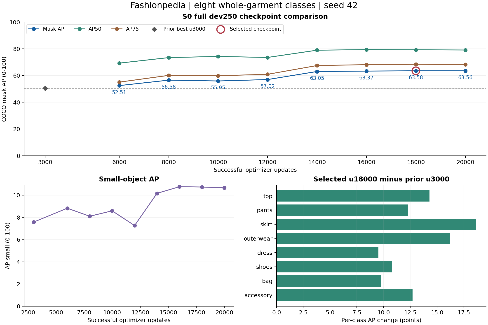

# 正式S0：AMP修复及18000→20000同预算恢复完成

2026-11-15。运行 `segmentation-s0-recovery20000-20261115-r01` 已完成20000步目标及八点完整dev250评价，按既定规则选中**18000步，mask AP=63.5791603**，比旧3000步50.5603136提升**13.0188467个AP点**。20000步AP=63.5595305，仅低0.0196298点，不据此声称显著退化或过拟合。训练与AP阶段完成不表示候选交付、语言评价或最终test已完成。

执行者lcy，决策与执行代理Codex。用户授权的单次阶段于**17:32:13–18:03:06 HKT**运行，含新增CUDA专项、续训、八点评价和选择，总耗时**1853.49秒（30.89分钟）**，低于10800秒硬上限；正常退出，无延长、自动重启或旧smoke。原失败run仍保留failed状态。

## 八点dev结果与选择

固定 `fp_dev250_v1` 全部250图/1008 GT；同一FP32 Mask2Former instance_inference、query×class top100、COCO segm AP协议，无语言阈值。八点评价使用七份已有6000–18000权重及唯一新增20000权重；旧3000只读已有报告，不重推理。各点均为完整250图；八次评价不是2000张独立图片。报告和hash见[dev记录](evidence/s0_recovery20000_20261115/dev/run_report.json)，总体九点比较见[选择记录](evidence/s0_recovery20000_20261115/overall_selection.json)。

| update | mask AP | AP50 | AP75 | AP small |
| --- | ---: | ---: | ---: | ---: |
| 3000（复用旧报告） | 50.5603 | 67.3544 | 53.2377 | 7.5811 |
| 6000 | 52.5083 | 69.3139 | 55.0981 | 8.8301 |
| 8000 | 56.5807 | 73.4491 | 60.1453 | 8.1073 |
| 10000 | 55.9522 | 74.3202 | 59.8923 | 8.5943 |
| 12000 | 57.0181 | 73.5643 | 60.9385 | 7.2691 |
| 14000 | 63.0537 | 78.9910 | 67.5121 | 10.1720 |
| 16000 | 63.3668 | 79.4239 | 68.1631 | 10.7665 |
| 18000（选中） | 63.5792 | 79.2945 | 68.4563 | 10.7389 |
| 20000 | 63.5595 | 79.1353 | 68.3130 | 10.6641 |

八类相对旧3000均提升；skirt提升18.6566、outerwear提升16.2126、AP small提升3.1578点。小目标AP仍低于整体，这是后续分析的实际局限；本轮不据此追加训练。

| 类别 | 旧3000 AP | 选中18000 AP | 变化（AP点） |
| --- | ---: | ---: | ---: |
| top | 56.5549 | 70.8459 | +14.2909 |
| pants | 69.3892 | 81.6369 | +12.2477 |
| skirt | 48.4508 | 67.1074 | +18.6566 |
| outerwear | 53.4679 | 69.6805 | +16.2126 |
| dress | 73.7763 | 83.2969 | +9.5206 |
| shoes | 39.9167 | 50.7061 | +10.7894 |
| bag | 38.1456 | 47.8814 | +9.7358 |
| accessory | 24.7811 | 37.4783 | +12.6971 |

选中权重仍引用上轮实际保存的文件，不另造best副本：

- 路径：`/root/autodl-tmp/fashion-grounding/runs/segmentation/segmentation-s0-20000-20261115-r01/train/checkpoint_018000.pth`
- SHA256：`207e2dbe1dcc8b9d0ef936d683d25af33c210347e34506914bbf6dad3426ee01`。
- 新20000恢复点：`/root/autodl-tmp/fashion-grounding/runs/segmentation/segmentation-s0-recovery20000-20261115-r01/train/checkpoint_020000.pth`，SHA256=`a16a7d5cf6bd49858a657e99ace13fc6b66950fff6d85bd9cd8ba226ca320744`；它完整可用，但不是本次AP规则选中者。

整体选择核查了旧3000与新八点；`overall_selection.json`顶层`compared_updates`列出全部九点，内嵌`selected.compared_updates`保留原同身份七点组的局部选择证据。结果是seed42的dev选择，未使用holdout test，不能代表最终泛化/端到端语言成绩。

## 实际恢复、溢出与稳定性

[六项恢复指纹](evidence/s0_recovery20000_20261115/train/resume_check.json)全部一致：model、optimizer、scheduler、scaler、sampler、RNG。目标仍20000，未重置scale、warmup或LR。18001–20000共2000条连续成功optimizer更新。

19315步再次出现与上轮相同图片ID `[27781, 30281]`、实例数`[1, 3]`及参数`backbone.res2.0.conv1.weight`的非有限梯度。唯一一次失败尝试跳过optimizer、不推进scheduler；scale从512降到256后，恢复sampler/RNG/model buffers并重放同一有效批次，随后成功完成到20000。见[溢出原始记录](evidence/s0_recovery20000_20261115/train/amp_overflow.jsonl)。没有把失败尝试算作一次成功update；成功记录的`skipped_optimizer_updates=0`不等于没有失败尝试。

[训练摘要](evidence/s0_recovery20000_20261115/metric_summary.json)：成功记录loss及梯度均有限；前100步平均总loss=12.3175、最后100步=12.1368。19315前后各100步均值10.4899/13.8551对应不同批次，不能单独据此判断退化。裁剪前梯度范数最大3539.6631，裁剪后最大约0.0100000；峰值CUDA allocated=4.397 GiB、reserved=5.168 GiB。训练进程内部耗时872.71秒；全阶段时间以上方协调器记录为准。

[旧/新轨迹前缀比较](evidence/s0_recovery20000_20261115/trajectory_prefix_comparison.json)只读既有日志：18001–19314共1314步均存在数值字段差异，不能宣称GPU跨进程轨迹逐位复现。六项初始状态核对与恢复后实际完成是本轮恢复结论；当前GPU算子没有逐位确定性保证，不把CPU小模型的精确复现扩大到真实GPU。上轮19314前的未保存更新只能从完整18000断点重做，这是本轮明确授权的恢复，不是额外smoke。

## 本次修复

- `amp_recovery`显式启用；每步最多4次重放，全程最多16次可恢复溢出，最低scale=0.0001，受同一时间上限约束。有限loss下发现非有限梯度，先由GradScaler跳过optimizer更新并降scale，再恢复sampler、全部RNG和model buffers，重放同一有效批次；失败尝试不推进scheduler或成功步数。非有限loss、上限耗尽或其他异常仍停止。
- 六项状态完整恢复，父scaler=512不手工重置；新checkpoint额外保存溢出累计次数。成功metrics和失败尝试分别记录，不能把成功记录有限冒称没有溢出。
- `--resume-repair`与预算扩展参数互斥，固定父权重hash、配置hash、源码tree和准确文件差异；max_updates保持20000，数据、LR、batch、增广等配方不改。不能靠增加目标步数或改checkpoint元信息绕过源码检查。
- 八点AP沿用原FP32上游top100/完整dev250入口。七份旧权重及修复后的20000权重具有不同训练commit/config，由新增审计入口逐份核对固定身份、源码差异、同一数据/协议与完整分母；原strict selector不放宽。最大mask AP优先，同分选更早步数；再与旧3000步已保存报告比较。
- GradScaler公开调用顺序依据[PyTorch AMP官方说明](https://docs.pytorch.org/docs/stable/notes/amp_examples.html)，实际部署环境的行为由本轮新增CUDA回归确认。

## 开工、配置与最小验证

整组GitHub开工快照：main=`7064ebb`、lcy=`73bc57d`、wkq=`f5787f4`、wyz=`103dcc5`。PR #2/#4为open/draft/unmerged，#5为open/non-draft/unmerged；#1/#3已关闭未合并；活跃PR无review/comment，队友最新交接无增量。见[GitHub快照](evidence/s0_recovery20000_20261115/github_preflight.json)。冻结train5000/dev250、官方COCO与八类加载、LSJ修复、既有恢复和AP接口证据均复用。新增范围只覆盖上轮19315失败所暴露的AMP异常处理、同预算源码恢复及跨修复选择。

实现提交`8c5c030`，实际执行提交`e6637ffab4e7f3a0871810043fee00b586629d12`，src tree=`c0747d2a2e95b5250081f942ec78d8365a2ac8d2`。只有分割服务器checkout快进到该提交，未改队友工作区或环境；后续文档提交不冒充执行源码。

- [训练配置](../../../configs/runs/segmentation/s0_recovery_20000.json) SHA256=`082027ad52aea05413326ea289989ac769bd8b2d15aa17a1d4b3ee9bdd5c64bd`：seed42、有效batch2、既定LSJ768与AdamW/LR配方不变。
- [同预算恢复策略](../../../configs/runs/segmentation/resume_repair_18000_to_20000.json)固定父权重/配置/源码与准确文件差异；[配置核查](evidence/s0_recovery20000_20261115/configuration_check.json)已通过。
- [阶段计划](../../../configs/runs/segmentation/s0_recovery_20000_stage_plan.json)：CUDA专项→训练→八点dev→选择，共用一个共享锁/进程组和总硬上限；外层10790秒硬终止，wrapper10795秒及最多5秒清理，无自动重启。
- [CPU专项](evidence/s0_recovery20000_20261115/cpu_validation.json)：10项AMP/恢复及3项选择边界通过；未重跑旧suite、COCO下载、旧smoke或旧候选推理。
- 一项微型Linear真实CUDA GradScaler注入溢出回归通过，主体0.852秒、进程阶段2.93秒；不加载Mask2Former/图片包，包含在本轮三小时内。随后真实19315溢出恢复及20000成功更新验证生产路径。见[阶段日志](evidence/s0_recovery20000_20261115/stage.log)。

实际命令和各阶段起止见[run_metadata](evidence/s0_recovery20000_20261115/run_metadata.json)、[phases](evidence/s0_recovery20000_20261115/phases.json)、[训练报告](evidence/s0_recovery20000_20261115/train/train_report.json)。阶段复跑入口有既存记录保护，本次没有重跑。

## 资源与证据交付

启动前GPU为0MiB/0%、无计算进程/running占用，系统/数据盘空闲约26.94/158.67GiB，见[启动资源](evidence/s0_recovery20000_20261115/server_preflight.json)。18:03:24 HKT结束核查为GPU0MiB/0%、无计算进程和active协调记录，系统/数据盘空闲26.94/158.04GiB，见[结束资源](evidence/s0_recovery20000_20261115/postflight.json)。已释放本轮GPU锁，未关闭实例或操作队友进程。

轻量证据归档SHA256=`ea9e904cc39373cfa58f67bef31e68fc87b073b0d503b811ae1b698f4037936d`，本地传输后验证归档及[manifest](evidence/s0_recovery20000_20261115/evidence_manifest.json)中45份原始成员hash。完整metrics、八份原始dev预测与checkpoint留服务器运行目录，路径/hash在run_metadata登记；不提交大文件。图由[脚本](evidence/s0_recovery20000_20261115/plot_results.py)仅从保存报告生成，无模型重跑。

## 下一项主线交付

本轮授权已完成并停止GPU工作。下一项是基于选中18000权重准备/交付正式候选，保留真实query ID与阈值前缓存，交给wyz/wkq消费；本轮尚未生成这些新候选。现有3000步三个trial包仅为旧版本，不改名冒充18000成果。语言matched coverage/阈值选择在accepted语言dev就绪后独立进行，不影响本次分割AP结论。暂不追加训练，也不重复已通过smoke。
