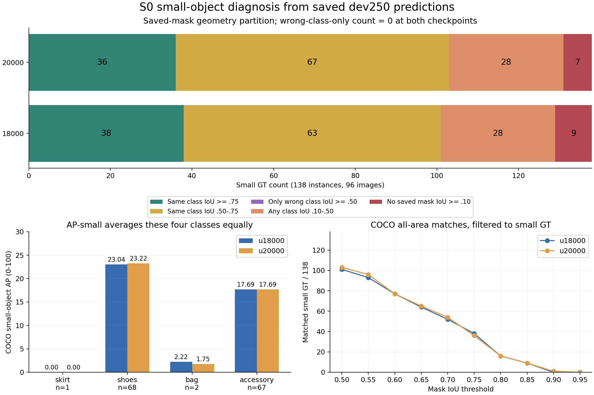

# 18000/20000步小目标离线诊断与训练决策

2026-11-15，segmentation / lcy，Codex执行。run=`segmentation-small-analysis-20261115-r01`，status=completed，执行源`33fcd74742cc53134aac83b128c7bbf999cf8407`。**不建议直接延长原训练配方；保留18000步为S0基线。小目标主要表现为高IoU形状/边界不足和部分漏检，错类独占几何不是当前主因。** 若后续另行授权优化，只做一个针对缩放增强的有界单因素对照，不自动增加正式S0步数。本轮没有训练、推理、模型加载、旧smoke或语言评价。

## 整组开工检查与复用范围

开工已fetch并核对全部远端分支、PR #1–#5及活跃PR评论/review：lcy=`32845db`、wkq=`f5787f4`、wyz=`103dcc5`、main=`7064ebb`；队友最新固定提交交接无新增。#2/#4 open-draft，#5 open非draft且base为#4分支，全部未合并；#1/#3 closed-unmerged，活跃PR评论为空。见[GitHub快照](evidence/small_analysis_20261115/github_preflight.json)。未修改队友工作区、分支或环境。

18:21:42 HKT服务器检查GPU0MiB/0%、无计算进程/active协调记录，系统/数据盘空闲26.94/158.04GiB，见[资源记录](evidence/small_analysis_20261115/server_preflight.json)。本次把已保存预测复制到本地CPU分析，CUDA_VISIBLE_DEVICES为空、BLAS/OMP单线程、合计600秒上限，不占GPU锁。离线COCO匹配用时1.939秒，匹配与补充统计两个进程合计2.456秒；数据传输/制图另计。

复用官方COCO/八类、LSJ修复、冻结train/dev、训练恢复、八点AP和选择等已有证据。新增问题仅是18000/20000的逐小目标错误类型与迁移：复用[已有匹配脚本](../../../scripts/analyze_saved_segmentation_predictions.py)，仅增加尺寸分组AP50/AP75/recall字段及可配置parent_run_ids；新增[小目标描述统计](../../../scripts/analyze_small_segmentation_errors.py)。只补[两个新增逻辑边界测试](evidence/small_analysis_20261115/new_logic_validation.json)，0.001秒通过，没有重跑旧测试套件。

## 固定输入与统计定义

输入为`fp_dev250_v1`的250图/1008GT，和`segmentation-s0-recovery20000-20261115-r01/dev/update_018000`、`update_020000`各25000条已存官方query×class top100预测；原权重和原报告不改。manifest/annotation、报告和两份预测SHA256均与上一轮记录一致。CPU匹配派生的整体、各尺寸及各类AP与原报告差异<1e-8；这是取得新逐实例证据所需的离线计算，不是重新推理。精确输入路径/hash见[运行记录](evidence/small_analysis_20261115/run_metadata.json)、[配置](../../../configs/runs/segmentation/dev_error_analysis_18000_20000.json)。

- 小目标：原图GT mask面积≤1024像素，非crowd/非ignore，共138例、96图。未删除失败或漏检。
- 下表的几何分类按每个GT在保存top100中的独立最大同类/异类IoU作互斥划分，不是一对一语言匹配，也不是TIDE式因果AP损失。
- 匹配计数取既有COCO all-area、按类别/score贪心匹配后的小目标子集。AP-small本身另按COCO面积ignore规则计算，不能把计数百分比冒称AP。
- score≥0.5是沿用的固定诊断切片，不是本次选择的生产阈值。保存score包含类别与mask质量，不支持分开归因内部logit；AP预测不含真实query ID，不能重建语言候选。
- 本轮只核对输入身份/评价一致性和定向可视化，没有重新认证全部标注质量；未发现版本或评价口径错配，不能据此证明所有GT均无歧义。

## 漏检、分类与高IoU几何

| 每个GT的保存预测状态（互斥） | 18000 | 20000 |
| --- | ---: | ---: |
| 正确类别最大IoU≥0.75 | 38 | 36 |
| 正确类别最大IoU在[0.5,0.75) | 63 | 67 |
| 只有错误类别达到IoU≥0.5 | 0 | 0 |
| 任意类别最大IoU在[0.1,0.5) | 28 | 28 |
| 任意类别最大IoU<0.1 | 9 | 7 |
| 合计 | 138 | 138 |

IoU≥0.5匹配为101/138→103/138（73.19%→74.64%）：101保留，2新增，0丢失，35两次均未匹配。IoU≥0.75为38/138→36/138（27.54%→26.09%）：35保留、3丢失、1新增、99两次未匹配；IoU≥0.8两者均16，≥0.85均9。说明20k获得少量粗定位收益，却没有系统性改善严格形状匹配。

“只有错误类别达到0.5”的实例为0，不等于分类完美。两次均有2个鞋GT，其重叠≥0.5预测里最高score类别为accessory，但同时存在正确鞋类别；分数均低于0.007。分类分数竞争确实存在，但不支持优先增加分类loss权重解决绝大部分小目标问题。

正确类别IoU≥0.5实例中，18k最大IoU掩膜的像素precision/recall中位数为0.8218/0.8607，20k为0.8169/0.8550；集合略有变化，不能当严格配对差值。这里precision=交集/预测面积、recall=交集/GT面积，是外溢与漏像素描述，并非轮廓距离或分辨率根因证明。

## AP-small低值及轻微回落的解释

| 小目标类别 | GT数 | AP18000 | AP20000 | AP50：18000→20000 | AP75：18000→20000 |
| --- | ---: | ---: | ---: | ---: | ---: |
| skirt | 1 | 0.0000 | 0.0000 | 0.0000→0.0000 | 0.0000→0.0000 |
| shoes | 68 | 23.0403 | 23.2202 | 62.1457→61.2773 | 12.8229→13.1851 |
| bag | 2 | 2.2248 | 1.7502 | 6.2991→5.6462 | 0.3258→0.2988 |
| accessory | 67 | 17.6906 | 17.6860 | 39.3914→39.6646 | 13.6006→15.5633 |

只有这四类有小目标正例；COCO在有效类别/阈值上平均，bag的2例与shoes的68例在类别宏平均中权重相同，skirt的1例也占四分之一。其它四类无小目标正例为N/A，不补0。该平均规则见[COCO官方实现](https://github.com/cocodataset/cocoapi/blob/master/PythonAPI/pycocotools/cocoeval.py)。因此AP-small=10.7389不是“138个小目标只识别对10.7%”。保持官方指标，不为了好看排除稀有类或重加权。

18k→20k AP-small净变化−0.0748点，按四类AP差的代数分解：shoes +0.0450、bag −0.1186、accessory −0.0011、skirt 0。**轻微回落主要由仅2例的bag子组拉动；鞋AP反而小升，不能说小目标全面退化。** 这不是因果误差贡献或显著性检验。

两个小bag均在IoU≥0.5被正确匹配，并非漏检，但AP50仅6.2991→5.6462；对应TP合成score为0.0223/0.0697→0.0211/0.0384。低AP还反映相对排序和误报影响，绝对score变化本身不能单独解释AP变化。全小目标IoU≥0.5的TP中，score≥0.5者74→73，而总匹配101→103；这仅是AP预测诊断，不是语言候选覆盖率，也不授权阈值选择。

## 哪些目标更难，以及可见错误

| 源细类 | 小目标数 | IoU≥0.5：18000→20000 | IoU≥0.75：18000→20000 |
| --- | ---: | ---: | ---: |
| shoe | 68 | 54→54 | 16→15 |
| belt | 11 | 5→5 | 1→1 |
| sock | 13 | 4→5 | 2→2 |
| glasses | 8 | 6→7 | 2→2 |
| headband, head covering, hair accessory | 14 | 10→10 | 4→3 |
| watch | 18 | 17→17 | 10→10 |

面积≤256像素子组36例，IoU≥0.5为19→20，≥0.75均3。小袜、腰带的IoU≥0.5分别4/13→5/13、5/11→5/11；但手表已达17/18，因此不能把整个accessory类统一判成未学会。dev稀有不等于train稀有，本轮没有用dev数量推断训练类别失衡。

用[渲染脚本](../../../scripts/render_small_segmentation_cases.py)只读6张定向选取图片和已存mask，原图/GT/18k同类/20k同类/20k异类并排；最近邻放大只用于观察像素，未改预测。选择规则和裁剪/hash见[案例记录](evidence/small_analysis_20261115/case_details.json)。这些是刻意选择的失败/变化例，不是随机质量样本：

- GT `1000006092`（图1000009794），424像素细长带状区域：两者最大同类IoU均0，异类也无有效重叠；是真正没有对应保存掩膜的例子。
- GT `1000008221`（图1000012292），930像素凉鞋：同类score约0.911/0.915，但IoU仅0.4941/0.4956；GT覆盖鞋带，预测将部分露出的脚部皮肤也纳入。18k覆盖GT约89.89%，却多包762像素，像素precision仅52.32%；20k仍多包763像素。主要是形状/孔洞与外溢，不是把鞋认成其它类。
- GT `1000001244`（图1000016529），596像素鞋：IoU约0.742两次持平，兼有漏像素与外溢，跨不过0.75。
- GT `1000006019`（图1000009765），140像素发饰：IoU0.461→0.223，外溢64→242像素；这是局部退步，不能代表全体。
- GT `1000007644`（图1000011092），453像素眼镜：IoU0→0.674，属于20k新增粗匹配，但score仅0.0144。
- GT `1000005368`（图1000009954），144像素鞋：同类与accessory都存在相近重叠，accessory分数略高；两种分数都很低，说明零错类独占不等于无分类竞争。

原图叠图留本地`outputs/segmentation-small-analysis-20261115-r01/visual_cases_zoomed/small_object_cases.png`，并在服务器同run目录镜像；图片不提交Git。Git提交数字诊断图及轻量JSON，全部逐GT/逐检测账本保留运行目录。

## 是否继续训练、具体改什么

**当前决策：不直接把原配方20000延长到更大步数；18000最佳权重及既有选择记录保持不变。** 本轮数据说明近邻2000步只改变少量小目标，无法证明更长训练一定有用或已彻底收敛。主学习率/骨干已为1e-6/1e-7，但没有证据把短板归因于学习率，所以不同时调LR、分类权重和分辨率。

若用户后续选择继续提高分割，建议一个有限的“保留小目标细节”实验：**仅把训练LSJ的min_scale从0.1改为0.5**，768画布、max_scale=2、batch2、学习率/优化器、数据和完整dev协议保持一致。当前mapper确实执行ResizeScale后FixedSizeCrop，见[项目实现](../../../src/fashion_grounding/segmentation/data.py)与[上游实现](https://github.com/facebookresearch/Mask2Former/blob/main/mask2former/data/dataset_mappers/coco_instance_new_baseline_dataset_mapper.py)。提高最小缩放可减少极端缩小；它是否改善边界/召回仍需对照，也可能因减少增广范围损害整体AP。仅凭本次dev预测不能证明训练缩放、输入分辨率或点采样谁是根因。

拟议对照可复用**已完成的18k→20k原配方作为A组**；若另获授权，B组从同一18k完整checkpoint开始，只改变上述一个参数、同样2000个成功updates，到20k评一次完整dev并复用同类错误统计。A组不重训，不重复旧smoke。该B组属于新训练配方实验，**不能套用只允许AMP源码修复的resume-repair门禁，也不能改checkpoint元数据绕过限制**；实施前须显式登记新配方过渡、预算及唯一允许差异。本轮没有编写或启动B组训练配置。

判断规则：正式权重仍按原定总体dev mask AP选择；同时看鞋/配饰小目标AP、IoU≥0.75计数和完整八类表现，防止收益只来自bag两例。若无明确整体收益，保留18k并停止该支线，不自动追加预算或第二轮调参。更高输入分辨率/边界点采样仅作为之后有证据再讨论的方向；当前不优先类别重采样/分类加权，更不改GT、评价门槛或混训。

下一项核心交付仍是选中18k的正式候选与接收方验收；这个有界优化提案不阻塞候选交付、wyz的M2或wkq语言审核。

## 可复核产物

[主匹配汇总](evidence/small_analysis_20261115/analysis.json)、[小目标汇总](evidence/small_analysis_20261115/small_errors.json)、[18k逐小目标](evidence/small_analysis_20261115/small_gt_18000.json)、[20k逐小目标](evidence/small_analysis_20261115/small_gt_20000.json)、[执行与交付回执](evidence/small_analysis_20261115/delivery_receipt.json)。本次registry只新增一条CPU派生分析run，mask_ap留空表示复用已有测量；不伪装成新训练或新模型评价。GPU调用、模型加载、optimizer更新、新推理、旧smoke均为0。
