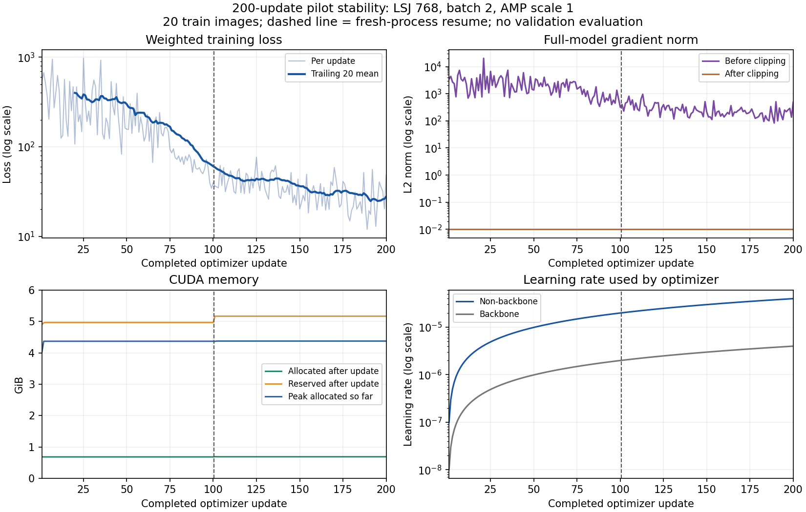

# 训练入口与 200-update 稳定性验收

任务 / 阶段：P1 分割训练工程检查；角色 / 成员：segmentation / lcy；状态：`gpu_verified`，未进行正式性能评价。分支 `segmentation/pilot-adapter-v1`，沿用 [draft PR #2](https://github.com/rickyliuchunyu/comp4471-fashion-grounding/pull/2)。成功运行代码 commit：`6ca15408c2f3b5b47b00935340c4e4635109ded5`，文档提交见 Git 历史。

## 实现与运行范围

新增正式可复用的 [train.py](../../../src/fashion_grounding/segmentation/train.py)、训练状态管理、LSJ mapper、[S0 配置模板](../../../configs/runs/segmentation/s0_train.json) 和 [200-update 配置](../../../configs/runs/segmentation/pilot_stability_200.json)。两种配置使用相同训练入口；S0 模板的数据 hash 尚未填写，未启动完整 20k 训练。dev AP evaluator、checkpoint 选择与冻结 train/dev 的接入仍待完成，P5-S 正式训练保持 not_started。

实际配方：LSJ 768、scale 0.1–2.0、随机水平翻转、microbatch 2 / accumulation 1、有效 batch 2、AMP 初始 scale 1；AdamW LR 1e-4、backbone 0.1 倍、weight decay 0.05，norm/embedding decay 0；full-model norm clip 0.01。保留官方 100 queries、10 次预测、30 项 weighted loss、Hungarian matching 和 12,544 点采样。

warmup 按完整方案保留 500 updates，从 LR 0.001 倍开始，没有把短检查改成更激进的学习率。第 1 次更新非骨干 LR 为 1e-7，第 200 次为 3.98602e-5；骨干为其 0.1 倍。本轮未到 warmup 结束或 12k/16k 衰减节点；节点行为由 CPU 单元测试检查，不能替代长期训练验证。

数据为现有 `shared/processed/fp_pilot20_v2`，20 张 Fashionpedia train 图 / 145 实例。image manifest SHA256：`1b1ec9f25c37cd7b910dfe2882cc33637be37f3fba32e6f7b0c32592b570f111`；annotation SHA256：`96f8edfce9b224992979cc282d6dc960849835cb06f0f83f5ad6e2ef225a4883`。初始化沿用已校验 COCO R50，完整文件 SHA256 `c18e6551f9c0e951e7ee3a63eb5402b901612e4e141965d4719d13c69a97ec2a`；镜像传输及八类适配证据见 [上阶段交接](coco_weights_20261112.md)。没有使用语言查询或 dev/test。

## 实测结果

| 项目 | 结果 |
| --- | --- |
| 成功 run | `segmentation-stability-200-20261112-r02` |
| update 数 | 1–200 连续，无缺失/重复，AMP 跳步 0 |
| batch / 样本曝光 | batch 2，400 次图片输入；20 张图重复 20 个 epoch |
| loss | 200 updates × 30 components 均有限；前 20 平均 **399.2898**，后 20 平均 **27.7036**；范围 11.9707–971.0303 |
| 梯度 | 均有限；裁剪前最大 L2 norm 20137.1602，裁剪后最大 0.0100000016（FP32 舍入范围） |
| 参数更新 | backbone 与 classifier 的初始化/最终指纹不同；最终所有 Adam state 的 step 均为 200，状态张量有限 |
| CUDA 峰值 | allocated **4.375 GiB**，reserved **5.168 GiB** |
| 持续显存 | update 1–20 / 81–100 的步后 allocated 中位数均约 0.681 GiB；新进程 101–120 / 181–200 均约 0.685 GiB；本轮未见持续增长 |
| 训练速度 | 每 update 中位 0.425 秒、P95 0.471 秒；两训练进程共 106.21 秒，含外层协调的总锁占用 112.57 秒 |
| 空目标增广 | 400 次输入中 1 次裁剪后为空，仍正常参与训练；未重采样或丢弃整张图 |
| 断点恢复 | 第 100 次保存退出；全新进程严格恢复六类状态，再完成 101–200 |

图中虚线为第 100 次后的进程恢复点。loss 为训练加权损失；LSJ 和重复小样本造成明显波动。loss 下降只说明这 20 张训练图上的优化正常，不证明泛化、mask AP 或正式 S0 效果。本轮未额外生成候选或评测模型。

## 断点恢复证据

- model、optimizer、scheduler、GradScaler、sampler、Python/numpy/CPU/CUDA RNG 六类组件均保存数值指纹；新进程恢复后的指纹逐项一致，见 [resume_check](evidence/stability_200_20261112/r02/updates_101_200/resume_check.json)。采样器包含 permutation、epoch、position 和独立 generator，没有 dataloader worker 预取。
- 实际 400 张图片的 ID 顺序与独立重建的连续采样序列完全一致。最终 checkpoint 再在 CPU 上解析、校验文件 hash 和全部组件指纹，Adam step 全部为 200，未初始化 CUDA，见 [final_checkpoint_check](evidence/stability_200_20261112/r02/final_checkpoint_check.json)。
- CPU 小模型测试另行比较连续训练与恢复训练后续 5 步的图片次序、随机数影响、loss 和最终参数，完全一致；真实 CUDA 自定义算子未证明 bitwise deterministic，因此 GPU 验收不宣称与另一条无中断轨迹逐 bit 相同。

服务器根目录为 `FG_ROOT=/root/autodl-tmp/fashion-grounding`。checkpoint 位于 `runs/segmentation/segmentation-stability-200-20261112-r02/` 下：

| 文件 | SHA256 |
| --- | --- |
| `updates_001_100/checkpoint_000100.pth` | `e52807441672b352b7f029664fd74f9f6455e746403c0a52e3c663149df6480f` |
| `updates_101_200/checkpoint_000200.pth` | `9b6a215c9294e3080539a6e03937182df37b4fa3665136283e981706d979002a` |

两个完整 checkpoint 共约 1 GiB，不提交 Git。恢复须用记录的执行 commit、同一 resolved config/data hash，输出到新目录；训练/恢复命令与机制见 [TRAINING.md](../../../envs/segmentation/TRAINING.md) 和实际 [commands.json](evidence/stability_200_20261112/r02/commands.json)。

## 失败记录与资源边界

`segmentation-stability-200-20261112-r01` 使用 commit `aa104da11f8eafabc2830ff4295bff2515777062`、AMP 初始 scale 128；完成 6 updates 后，第 7 次反向传播产生非有限 gradient norm，裁剪检查失败，未执行第 7 次 optimizer step，也未到达第 100 次 checkpoint。原 [日志](evidence/stability_200_20261112/r01/phase_1.log)、[6 步 telemetry](evidence/stability_200_20261112/r01/updates_001_100/metrics.jsonl)、配置和失败协调记录完整保留。不能声称失败尝试没有发生或将它拼入成功轨迹。

成功 r02 从相同 COCO 初始化重新开始，初始 scale 改为 1，200 次中均保持 1。两个尝试共执行了 206 次成功 optimizer updates，其中 6 次只属于失败诊断；报告的稳定性轨迹是 r02 独立的 200 次。没有关闭非有限检查或将跳步计为成功；训练器现增加了 `gradient_failure.json` 诊断，以便后续失败时定位梯度参数。

运行前 RTX 3090 显存 0 MiB、无 GPU 计算进程、无 running 协调记录；系统盘约剩 27 GiB，数据盘已为 200 GiB、约剩 172 GiB（扩容不是本轮执行）。共享锁包住两进程，硬时限 900 秒。结束后 GPU 显存恢复 0 MiB，无计算进程；系统/数据盘约剩 27/170.3 GiB。成功 run 目录约 1009 MiB，失败目录保留；旧项目、其他成员环境/进程和原共享数据未改动。

## 测试、交接与下一步

本机 35 项测试通过，1 个需 Detectron2 的测试类跳过；服务器 36 项通过，包含真实 LSJ/RLE 几何、空目标和 RNG replay。训练状态测试覆盖 optimizer 分组、LR 边界、配置约束、跨 epoch 恢复等价性、损坏/不匹配 checkpoint 拒绝。见 [服务器测试日志](evidence/stability_200_20261112/r02/tests.log)、[环境指纹](evidence/stability_200_20261112/r02/environment.json)。

运行登记追加 failed / completed 两行；正式性能指标均留空。元信息：[r01](evidence/stability_200_20261112/segmentation-stability-200-20261112-r01-metadata.json)、[r02](evidence/stability_200_20261112/segmentation-stability-200-20261112-r02-metadata.json)；[汇总](evidence/stability_200_20261112/r02/stability_report.json) 与逐步 JSONL 是数字来源。图可用 `scripts/plot_segmentation_stability.py` 从证据重建。

下游 grounding/data_eval 尚未复核，本轮只交接训练与恢复能力，不发布正式候选。下一项是冻结 train/dev 数据消费、接入标准 COCO AP 的 dev evaluator 和 checkpoint 选择，再另行确定完整训练预算；不自动延长本次 200-update 检查。microbatch 1 / accumulation 2、其他尺寸、长期 AMP scale 增长及 warmup 后的稳定性仍未在真实 GPU 上验证。
