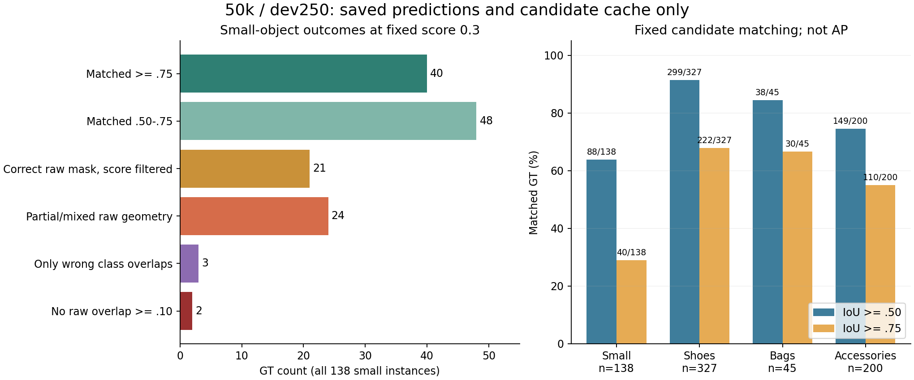

# 50k剩余分割错误分析与下一项优化

2026-11-18，lcy / segmentation，Codex执行；**completed / offline diagnosis only**。执行源`3e4fb9457f13c3f5aa825770a8a0755d1b385ea4`。使用现有50k完整dev250 AP预测、阈值前候选缓存、固定0.3候选和已完成关联账本；不加载权重、不推理、不训练、不重算AP或重跑smoke。当前正式开发候选仍是50k＋0.3，未改阈值、预测、标注或队友代码。

## 结论

优先问题是**小目标的低分丢弃与局部形状不足，并伴随细边界外溢**；仅异类mask达标并非小目标漏检的主要部分。类别8内部差异很大，袜/腰带/细头饰需要针对性处理，不能统一提高整个配饰类别权重。下一项建议准备现有10k上的弱细类/小目标图像重采样单因素对照，保留完整图片与原增强；收益尚未验证，本轮不启动。

## 固定0.3的全量结果

全部1008个非crowd/非ignored GT均纳入；small定义为原图mask面积≤1024。表内小目标与类别切片有重叠，不能相加。匹配采用现有同类、分数/ID排序、IoU≥阈值、一对一规则；这些计数不是COCO AP/AR。

| 切片 | GT | 匹配IoU≥.5 | 匹配IoU≥.75 | 同类缓存mask达标但分数被过滤 | 局部/混合几何不足 | 仅异类缓存mask达标 | 全缓存IoU均<.1 |
| --- | ---: | ---: | ---: | ---: | ---: | ---: | ---: |
| 全dev | 1008 | 884 | 743 | 59 | 41 | 22 | 2 |
| 小目标 | 138 | 88 | 40 | 21 | 24 | 3 | 2 |
| 鞋 | 327 | 299 | 222 | 12 | 14 | 2 | 0 |
| 包 | 45 | 38 | 30 | 3 | 1 | 3 | 0 |
| 配饰 | 200 | 149 | 110 | 22 | 22 | 5 | 2 |

未匹配原因按固定优先级互斥分解：若选中包存在同类IoU≥.5却被其他GT占用，先记一对一竞争（本轮0）；再检查同类缓存mask是否达标但被阈值过滤；再判仅异类达标；然后局部重叠；最后无明显重叠。低分过滤与分类分支可能同时有问题，不能把该表当作互相独立的因果贡献或TIDE AP损失。

## 小目标：形状和评分都需要改善

138个小目标中，固定0.3保留88个同类匹配；50个未匹配分为21个低分过滤、24个局部/混合几何、3个仅异类达标和2个无明显重叠。面积≤256的36个极小目标只有10个匹配.5、3个匹配.75。

阈值前缓存独立最大同类IoU≥.5为109/138，AP top100为112/138，固定0.3为88/138。两个解码路径分开计算；AP只有本次文件内ordinal，不伪造decoder query ID。独立最大IoU是可用mask几何上界，不是一对一生产recall，更不是把所有低分query放入系统后的性能。

21个低分小目标的最佳同类候选分数：中位数0.002517，四分之三不超过0.013693，最高0.124004。当前分数是类别概率×mask质量，原logits未缓存，因此不能断言全部是分类头置信度问题。它们多数远低于0.3，不支持“小幅下调阈值即可修好”；直接保留全部23871个缓存候选也会引入大量低分预测。本轮未搜索新阈值，仍沿用已选0.3。

88个已匹配小目标中，48个匹配IoU仍低于.75。其像素precision均值0.8144、recall均值0.8731；38个precision<.8，14个recall<.8（两者可重叠），在这个已匹配子集里外溢更常见。1原图像素内边界IoU均值0.2211，仅为严格薄边界描述指标，对极小目标/1像素偏移敏感，不是标准Boundary AP，也不能跨尺寸直接解释好坏。

## 鞋、包、配饰的区别

- **鞋：**299/327匹配.5，但只有222/327匹配.75；小鞋48/68与20/68。小鞋已匹配集合precision均值0.7987、recall0.8765，22/48的precision<.8。重点是细带、镂空及可见区域形状，不能把91.44%的宽松匹配写成边界已好。
- **包：**38/45与30/45；7个未匹配为3低分、3仅异类达标、1局部几何。小包仅2例、匹配1例，证据不足以围绕这2例选方案。以全部45个包及整体AP监控即可。
- **配饰：**149/200与110/200，51个未匹配中22低分、22局部几何、5仅异类达标、2无重叠。类别内差异如下，不把眼镜/袜/腰带视为同一种难度。

| 配饰源细类 | GT | 匹配.5 | 匹配.75 |
| --- | ---: | ---: | ---: |
| sock | 17 | 6 | 3 |
| belt | 47 | 30 | 17 |
| headband, head covering, hair accessory | 24 | 17 | 9 |
| watch | 25 | 17 | 14 |
| glasses | 26 | 26 | 20 |
| tights, stockings | 30 | 29 | 27 |

固定0.3的1279个预测中，884个同类匹配，剩余395个按预测侧分为：151个背景/未标注区域、117个局部/混合几何、110个异类重叠、17个同类重复。配饰288个候选中149个匹配，另有89个背景/未标注区域预测；整体提高配饰权重或统一降阈值存在放大误报的风险。同类重复只占17/395，优先处理评分与形状。

已有642条语言查询里未覆盖40条，对应20个独立GT，按本次GT账本映射为22条低分、8条局部几何、10条仅异类达标。只复用原查询覆盖账本，没有重新运行语言评价、排序或改分母；当前93.7695%覆盖结论保持。

## 失败图核看

从全量统计中确定性选择8个说明案例，Codex已查看两个页面；这是模型辅助看图，不冒称独立人工数据验收，也不是随机性能样本。页面及全部1008逐GT/1279逐预测账本保留服务器，路径/hash见[产物索引](evidence/u50000_diagnostics_20261118/server_artifacts.json)。

- GT1000002490：凉鞋候选分数0.9769，IoU0.504，填入GT不包含的脚趾区域，说明高分也可能形状外溢。
- GT1000003119：遮挡鞋的GT包含分离的可见区域，最佳同类缓存mask只覆盖局部，IoU0.164。
- GT1000002152：手表mask IoU0.859，但分数0.001040，属于有几何而评分极低的例子。
- GT1000003207：细腰带没有IoU≥.1的缓存mask；GT1000005209的细头饰则已有高分匹配但轮廓偏移。
- 部分包的源GT涉及细肩带/多个可见片段。这些案例按原Fashionpedia实例粒度诊断，不改源mask、不合并/拆分实例，不把理想整件轮廓当作现有GT，也不据8例判定数据集错误。

## 下一项优化建议：先准备一项受控改动

**第一优先：现有10k内的弱细类/小目标图像重采样。** 目标是增加这些目标连同背景、相邻物体的有效训练出现次数，兼顾评分与形状学习。建议B组75%图像曝光仍均匀采样，25%从含小袜、腰带、细小鞋、头饰/手表的train图像池采样；池只用train源类别与面积构建，每图保留全部八类实例和原mask。同一图命中多个池只作为一张图处理，记录重复次数和实际各组曝光。不得按dev图ID选训练样本，不改数据包。

这是一项待验证假设，不是已证明的根因修复。新增5k本身已补入429张小袜、548张小腰带、1297张小鞋目标图；优先使用已接收数据，暂不再次扩包。保留当前768/LSJ0.5–2和完整图训练：此前25%目标裁剪损伤同图其他实例的负结果仍有效，不重复该诊断，不启用原负裁剪方案。

拟议A/B从同一50k**仅加载模型参数**，相同优化器重置、学习率/调度、种子、有效batch2及预算；A保留当前采样，B只改采样。先各1等效epoch=5000 updates=10000次图像曝光（重采样下不等于每图遍历一次），末端各一次完整dev250评价。不能把旧50k直接当作“相同新增训练预算A组”，否则无法区分多训练与采样收益。本轮仅提出方案，没有实现/启动A/B。

建议在执行前固定工程筛选门槛：B总体AP不低于A，且AP_small至少+1.0点或鞋/包/配饰宏平均AP至少+0.5点；AP75不低于A。门槛只是有限预算决策规则，单dev/单seed不构成显著性证明；只有通过总体选择与针对性改善才替换当前50k。候选改版时仍保持0.3，检查小目标漏检/外溢是否降低、配饰误报是否增加，不能重新选阈值掩盖退化。

**第二优先：边界/小目标监督的单因素改动。** 如果重采样对照后细带、镂空外溢仍占主导，再考虑仅在mask loss中加入小目标/边界点保底，保持分类、Hungarian匹配、输入尺度及采样配方固定。当前没有训练时logit/点命中数据，尚不能证明原点采样漏监督；需要该新增机制的必要验证与独立对照，不能与重采样同时改。

当前不优先：直接追加同配方长训练、统一类别权重、再跑旧800→1024推理对照或恢复负结果裁剪。历史B20k单独放大推理到1024整体AP下降的结果继续保留；它不能证明所有训练尺度适配无效，但不足以支持直接切换交付配置。既有50k和0.3仍为有效版本。

## 执行与复用证据

- [汇总JSON](evidence/u50000_diagnostics_20261118/summary.json)、[案例账本](evidence/u50000_diagnostics_20261118/selected_cases.json)、[图像展示回执](evidence/u50000_diagnostics_20261118/visual_receipt.json)。
- [输入hash配置](../../../configs/runs/segmentation/u50000_diagnostics.json)、[执行回执](evidence/u50000_diagnostics_20261118/execution_receipt.json)、[CPU日志](evidence/u50000_diagnostics_20261118/execution.log)。
- [新增逻辑的3项CPU检查](evidence/u50000_diagnostics_20261118/new_logic_tests.log)：匹配并列/类别、阈值边界/空输入/一对一，以及互斥原因优先级；未跑旧测试套件。真实246张查询图的矩阵关联与既有coverage关联完全一致，作为新推导口径校验。
- 主体CPU诊断6.603秒，外层300秒硬限；绘图另限60秒。CUDA_VISIBLE_DEVICES为空，torch未导入；0模型加载/推理/训练/AP重算/smoke。只读取既有输出身份和必要mask，未重新验收数据/环境/训练恢复。
- 全组GitHub分支及5份PR/活跃讨论已查：本人开工40c3c4a，wkq b24515b、wyz103dcc5、main7064ebb均未变；固定commit交接复用。服务器自己的干净checkout用于CPU分析，未申请GPU锁或修改队友目录；[结束资源](evidence/u50000_diagnostics_20261118/postflight.json) GPU0MiB、无活动协调记录。
- 完整逐实例账本/失败图留服务器，Git只发布代码、小型汇总及派生统计图；[传输hash](evidence/u50000_diagnostics_20261118/transfer_receipt.json)已核对。PR #2继续draft，历史正文未因既有连接器403而重试；以分支状态与本交接为当前结果。
