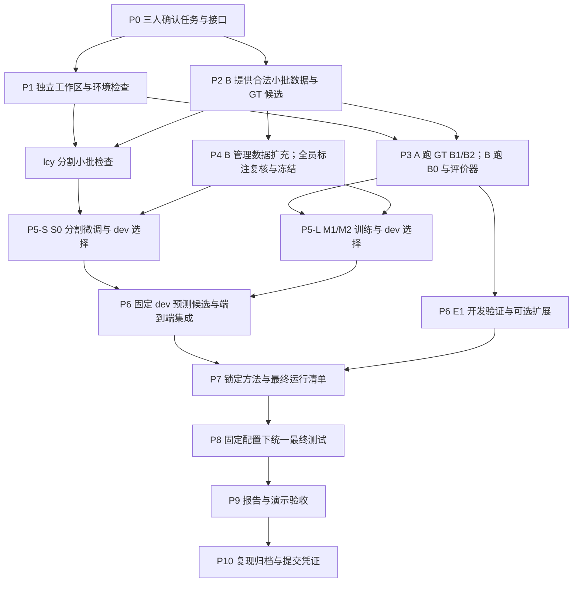

# 完整工作流程：从开工到最终交付

版本：2026-11-10。本文规定三人工作的依赖顺序、并行方式与交接条件；它是执行路线，不是已完成记录，不承诺训练时长或具体运行日期。实际进度入口是 [状态表](status.md)，以代码、[运行登记](../experiments/registry.csv) 和 [交接证据](handoffs/README.md) 为准。

暂定职责与已确认成员：**lcy = 分割与候选；wyz（A）= 图文匹配与排序；wkq（B）= 数据与评估。** 下文 A/B 分别指 wyz/wkq；成员简称于 2026-11-11 绑定，不代表 GitHub/SSH 访问已核验。详细职责、目录、权限与交接格式见 [团队说明](team_workflow.md)，具体算法和评价定义仍以 [技术设计](technical_design.md)、[数据协议](data_protocol.md)、[实验计划](experiment_plan.md) 和 [实现规范](implementation_spec.md) 为准。

## 1. 先看总体顺序

**先统一接口并提供小批 GT 数据，再并行开发分割、语言和评价；在开发集接通后锁定方案，最后统一测试、写报告和演示。**

箭头表示需要的输入，不表示所有开发都串行。P1 与 P2、P3 与 P4 可以并行；P5-S 和 P5-L 在软件开发层面并行，单卡 GPU 计算需排队。S0 只需合格分割数据，不必等待完整语言查询集。

## 2. 阶段总表

| 阶段 | 先决条件 | 主动作与交接 | 放行证据 |
| --- | --- | --- | --- |
| P0 范围与接口 | 仓库可读取 | 三人确认角色、类别、坐标、schema 和推理边界 | 协议版本及可读示例 |
| P1 环境与工作区 | P0；远程操作另需已授权访问 | 各自 checkout/环境，lcy 协调单卡与旧镜像核查 | 环境记录、独立目录、各模块最小检查 |
| P2 小批 GT 数据 | P0，不依赖模型训练 | B 转换验证，全员提供/复核描述，交给 lcy/A | 合法真实图片、GT 实例、查询及哈希 |
| P3 基线与评价器 | P2，相关模块环境可用 | A 运行 B1/B2，B 实现 B0 与统一评分 | 完整预测、手算边界检查和初步指标 |
| P4 数据扩充与冻结 | P2 的规则可用；可与 P3 并行 | B 管理，全员标注复核，发布分割/语言各自的数据包 | 图片组不跨区、版本化 manifest、统计及复核记录 |
| P5-S 分割正式训练 | P1 分割检查通过，P4 分割数据就绪 | lcy 跑 S0，dev 选权重与候选解码 | 可恢复 checkpoint、dev AP、固定候选配置 |
| P5-L 排序正式训练 | P3 检查通过，P4 语言数据就绪 | A 缓存 train/dev 特征，训练 M1/M2 | 公平预算、冻结参数检查、各 seed/dev 结果 |
| P6 集成与开发对照 | P3 与两条 P5 的相关产物 | lcy 给候选，A 给预测，B 统一评价；接 E1/demo | dev 全流程、覆盖率/选择/边界错误与计时 |
| P7 方法锁定 | 核心开发验证完成；扩展执行或明确不做 | 三人固定权重、配置、数据、版本与评价脚本 | 最终运行清单与 freeze 记录 |
| P8 最终测试 | P7 | 在冻结 test 上运行、统一统计，失败保留 | 全查询预测、指标、分组/区间及运行证据 |
| P9 报告与演示 | P8 的核心结果齐全 | 各写负责部分，全员审查结论/引用/限制 | 数字可追溯、demo 可运行、稿件与证据一致 |
| P10 归档与提交 | P9 检查完成 | 归档环境/代码/配置/结果，按课程要求提交 | 可复现索引；提交完成另需真实回执 |

## 3. P0：三人共同确认接口

lcy 确认分割器产生什么，A 确认排序器读取什么，B 将约定整理成读写与验证规则。首先确认：八类项目编号 1–8、训练内部编号 0–7、原图 RGB、`xyxy` 排他右下界、原图尺寸 mask、稳定图片/实例/候选 ID，以及查询的唯一目标。

按 [文件契约](artifact_contract.md) 读取已有 GT/预测候选完整合成例，执行示例检查，再实现正式读写器；答案字段只在训练/评价中使用，不进入推理。仓库现有 illustrative 示例不算真实标注。

**通过条件：**三人能指出同一个字段的含义、生产方和使用方。按 lcy/wyz/wkq 的已确认角色开展工作；未确认的账号权限与机器状态以状态表和交接证据为准，不因此阻塞无依赖的代码设计。

## 4. P1：环境准备；P2：数据试点，两条线同时开始

### P1 的三人任务

- **lcy：**在获准使用的 AutoDL 实例上检查已有环境、显卡/驱动、CUDA 工具链、Detectron2 和 Mask2Former 自定义算子；先保留旧环境，验证分割前向、反向和保存恢复。
- **A：**独立核查图文环境，加载固定 revision 的 SigLIP 2 和 processor，验证一张图/一句话的特征维度、数值与标准 logits。
- **B：**建立可独立运行的数据与评价依赖，先做 schema、RLE/mask、坐标和匹配的 CPU 小例子。

各自独立 clone 和分支，记录实际环境名称/路径。GPU 占用按 [团队规则](team_workflow.md) 协调；两个 tmux 会话不等于两张 GPU。没有远程访问时继续本地实现、检查与数据工作，不假称远程验证成功。

### P2 的三人任务

B 先用少量真实 Fashionpedia 图完成转换，核对整件/部件/jumpsuit 规则、类别映射、图像尺寸和 mask 解码。全员为适合的图片写少量中英文描述并交叉复核。先交小批合法数据，不等待全部目标数量达到后才交接。

B 发布版本化小包，包含图片 manifest、分割标注、GT 候选、accepted 查询、源数据与转换配置哈希、检查报告和叠图。A 验证候选能直接裁剪，lcy 验证标注能接分割 loader。

试点使用训练来源；正式划分须保持官方边界和重复组约束。后续扩大数据范围时重新检查跨包重复关系，不把试点开发用过的图片转进最终 test。合成夹具仅用于检查逻辑，不计入数据规模或性能。

**通过条件：**图片和 mask 真实可解码、框与实例一致、查询目标存在且唯一、各方可以读入。元数据数量正确不能替代图像和 mask 检查。

## 5. P3：先跑 GT 语言基线和统一评价

这里的 GT 候选来自真实标注，不依赖 S0 的预测。

1. **A** 用统一 GT 裁剪生成冻结特征，跑 B1；加入已定义的位置规则得到 B2。试点先用固定且有记录的设置检查流程，不搜索权重；正式规则权重待 P4 的 dev 数据就绪后选择。
2. **B** 跑 B0，并实现同一个评价器。推理只读取图片、候选和文字，评价器才读取目标标签。
3. **B** 用可手算样本验证正确、选错、漏检、空输出、重复候选、错类但几何重叠等情况；**A/lcy** 交叉核查。
4. 三种基线输出统一记录，B 生成初步 GT 结果、按语言/类别/困难程度分组；明确结果来自试点还是正式 dev。
5. **lcy** 同时继续分割小批训练与恢复验证，不等待语言模型完成。

**交付：**B0/B1/B2 的实现、统一预测格式、评价器检查证据、GT 结果和失败状态。此阶段回答“候选正确时能否理解描述”，不能把它写成实际完整系统性能。

## 6. P4：扩充标注并冻结数据版本

P4 可与 P3 并行。B 负责图片分组、去重、划分和批次管理；三人分担描述撰写、另一人独立选择目标的复核。测试描述遵守独立人工撰写要求，生成后人工修改如实记录来源。

分别发布：

- **分割 train/dev 数据包：**图片、实例标注、类别映射与统计；合格后即可供 S0 正式训练，不必等语言标注完成。
- **语言 train/dev 数据包：**同图候选、复核描述、目标 ID、语言与配对组，供 M1/M2 训练和选择。
- **冻结 test 定义：**图片组/查询版本与评价范围，独立保留；只做数据质量复核，不用模型测试表现调参。

同图翻译、改写和反事实不能跨分区。标注数量使用实际值，计划范围是预算目标，不为凑数接受模糊描述。B 发布后，A/lcy 在各自入口核对 hash 和字段。

**通过条件：**对应训练所需的数据包完整、无已知跨区重叠、记录作者/复核者、实际类别与困难样本统计齐全。数据版本升级时记录变更，并让所有受影响方法采用相同版本。

## 7. P5：两条训练线并行开发，GPU 排队执行

### P5-S：lcy 训练分割 S0

先完成短训练、显存/速度实测和 checkpoint 恢复，再在已授权预算内微调。按 dev mask AP 选择 checkpoint，按 [预登记选择规则](experiment_plan.md#2-固定条件与选择规则) 最大化 matched coverage，并按候选数/较高阈值打破并列，在 dev 选择一次阈值。保存原始 AP 推理输出与语言候选解码配置，两者不混用。

先导出 **train/dev** 固定候选及 manifest 给 A/B；test 的最终预测与评分留到 P8。候选包含稳定 ID/顺序、类别/分数、框、原图 mask 和来源 hash。B 检查几何/关联覆盖率，A 检查裁剪与缓存。

### P5-L：A 训练外观与空间排序 M1/M2

先缓存冻结 SigLIP 2 的 train/dev 区域与文本特征，再训练小网络。M1/M2 的数据、外观结构、预算、候选和模型选择协议可比；只新增空间分支来测量其作用。

检查零残差初始化、冻结编码器梯度、padding、单/空候选处理以及恢复训练。记录预定种子的真实运行，用 oracle dev selection accuracy 选择权重；不读取 test 表现。

### B 同时做什么

核查训练输入版本与复核情况，完善指标和语言挑战分组，汇总已完成的 dev 运行，开发候选叠图和诊断界面。没有 GPU 空闲时继续这些 CPU 工作。

**通过条件：**两条线各自拥有可恢复权重、真实日志、固定输入、运行配置与 dev 结果。训练 loss 下降或小样本过拟合不等于泛化提升。

## 8. P6：开发集端到端集成、E1 和扩展选择

核心交接顺序：**lcy 的固定 dev 候选 → A/B 的各方法预测 → B 的统一评价 → 三人分析错误。**

- B0/B1/B2/M1/M2 共享同一套候选和评价查询；B 计算预测选择准确率、目标 IoU、Success@0.5、覆盖率和条件准确率。
- 分清漏检、选错和边界误差；几何 recall 和同类一对一匹配 coverage 不混用。
- 若启用预测候选适配，只用训练划分预测候选，M1/M2 使用一致协议，记录漏检排除率；dev/test 不用于参数训练。
- lcy 接通最小 pipeline，A 提供排序调用，B 接入展示。用户路径不读取 GT，诊断时的 GT 图层另行标识。
- 测量首次新图与同图新查询两种延迟；缓存、模型重载、图像预处理及界面耗时的范围写清楚。

**E1 可提前并行准备：**A 检查外部系统访问和依赖，lcy 协助部署，B 适配端到端评价。在 dev 选定一种系统和固定输出规则；使用它自身的候选，不能冒充共享候选消融。若候选系统不适用，按已有替代路线记录；不能把 E1 静默删掉或编造结果。

**扩展决策：**核心 dev 流程跑通后，根据剩余预算选择 X3/交互等，或明确不做。扩展方法、阈值和评价组在 P7 前确定；即使不做任何扩展，核心路线仍能进入最终阶段。不要先看最终 test 再决定哪个扩展最值得汇报。

**通过条件：**端到端输出合法、统一评价无已知错误、核心对照和 E1 开发路线明确、扩展有明确取舍。若只是开发成功而没有完整运行，准确写出状态。

## 9. P7：锁定方案，才能进入最终测试

B 整理 freeze 清单，方法负责人核对各自条目，固定：

1. 代码 commit、环境、公开权重来源与哈希。
2. 数据/查询/schema/类别映射/候选 manifest 版本。
3. S0/M1/M2 权重与种子，是否使用预测候选适配。
4. 候选解码、B0/B2 规则词表与权重、预处理与缓存策略。
5. E1 系统、checkpoint、输入语言/翻译方式和多输出选择规则。
6. 评价关联、失败计分、分组定义、D1/D2、中英配对及统计/计时协议。
7. 实际选定的扩展、最终运行列表、各负责人和预算。

交接目录和模板已有；具体冻结记录在 `docs/handoffs/` 实际执行时创建，入口见 [交接说明](handoffs/README.md)；不把本流程文档当冻结证据。其他成员复核已完成的配置，不要求每个运行重复审批；执行仍遵守已有预算和共享 GPU 协调。

**通过条件：**最终运行清单中的每项都可追溯到确定输入与方法；未解决问题标为待解决或局限，不用 test 代替 dev 排查。

## 10. P8：统一最终测试与统计

1. **lcy** 使用冻结分割权重和解码配置处理 test，分别产出分割评价输出和内部方法共用的语言候选。
2. **A/B** 在同一 test manifest 上运行各自方法；内部方法同时保留 GT 候选诊断与预测候选端到端结果。GT 条件仅供诊断，不混入实际推理。
3. **A** 运行固定 E1；外部系统结果单独列系统对照，不能从多输出中用 GT 挑最优。
4. **B** 统一评价全查询，保留空输出、漏检、拒绝与运行失败，形成逐条预测和分组计数。
5. **B** 汇总种子结果、图片级配对区间、D1/D2/双语配对、延迟和显存；三人核查明显异常和失败样本。

纯基础设施中断可以在相同冻结配置下续跑/重跑，记录原因和新运行 ID。若发现评价 bug 或标注错误，修订须对所有受影响方法一致应用并保留旧版本；不能借修复调模型迎合已看过的 test。任何方法变更造成测试反馈污染时应如实说明，必要时另设未使用的 holdout。

**通过条件：**核心表中的数字能追到预测、日志和配置；未运行项明确空缺，不能填目标值。完成测试不要求新模块一定优于基线。

## 11. P9：报告与演示

- **lcy：**分割方法、S0 结果、候选质量、漏检和边界错误。
- **A：**SigLIP 2 与原编码器选择依据、外观/空间方法、B1/B2/M1/M2/E1 对照与消融。
- **B：**数据协议、实际标注数量、统一指标、分组统计、语言挑战与案例展示。
- **全员：**Introduction、Problem Statement、结论、局限、引用、作者信息和全文数字一致性。

报告要区分已有证据、实测结果、设计理由和未实现扩展；已完成实验不叙述时间线。GT 结果、预测候选结果、外部系统结果不可混表后暗示同条件提升。演示包含正常案例与合理失败状态，不能只硬编码成功样本或显示虚假置信概率。

训练还在推进时可以先写方法、数据协议和报告骨架；最终结果和结论必须等真实证据。演示开发可以从 P6 开始，不需要等全文写完。

**通过条件：**方法、数据、指标、引用和限制一致；演示的代码/权重对应报告版本；PDF/图表经过检查。遵守课程实际提交要求，不把 milestone 的页数要求自动套到 final report。

## 12. P10：复现归档、提交与算力收尾

B 整理结果索引，方法负责人补齐实际命令和依赖；在干净工作目录用小型公开/可授权样例检查加载与推理，不为文档验证重复整轮训练。保留源码 commit、环境清单、配置、数据/权重 hash、全查询预测和日志。

大文件备份到受控存储，GitHub 保存小型配置/指标/说明与不含凭据的索引。课程提交由被授权的成员操作，保存真实回执；仓库 push 或本地 PDF 存在不等于已提交课程系统。

确认其他成员没有运行任务后，按实例负责人授权关机。不要为省钱直接释放实例、删除共享数据或结束他人任务。

## 13. 单卡 GPU 的推荐排队方式

先用短任务解除接口与环境不确定性，再分配长训练窗口。顺序可随数据就绪情况调整，不代表三个成员必须一直等待：

1. 分割与图文各自的短前向/反向/恢复检查。
2. 合法小批 GT 特征与 B1/B2 基线。
3. 正式 train/dev 冻结特征缓存（对应数据已就绪时），完成后释放大编码器显存。
4. S0 的训练窗口；A/B 同时做 CPU 代码、评价和标注。
5. M1/M2 的训练窗口；如 CPU 缓存训练已验证足够，可用 CPU，不能未经测试就假设与 GPU 性能相同。
6. dev 预测候选、E1、计时和已选扩展分别排队。
7. 方法冻结后，按最终清单执行 test 任务。

S0 可早于完整语言缓存开始；若某条线未就绪，执行另一条已满足前提的任务，不无意义空等。所有 GPU 使用者遵守同一占用登记/锁；关机和预算沿用团队规则。最终计时不与其他负载同时运行。

## 14. 上游未就绪时做什么

| 暂缺内容 | 可以继续 | 不应做 |
| --- | --- | --- |
| 服务器/SSH | schema、CPU 评价器、小夹具、数据协议与标注 | 宣称远程 GPU 检查通过 |
| 全量真实数据 | 小批合法试点、读写/错误处理、模型接口 | 用合成或示例冒充正式数据 |
| S0 完成权重 | GT B0/B1/B2、M1/M2、查询复核 | 因此让所有人停工 |
| 完整语言标注 | 已冻结分割数据上的 S0、评价器、短样本流程 | 用 dev/test 补训练数量 |
| GPU 空闲 | CPU 数据/评价/文档、准备下个运行配置 | 杀掉别人进程或并发抢显存 |
| E1 环境 | 核心内部方法继续，按协议检查替代系统 | 静默省略必要对照或编造结果 |

## 15. 每阶段交接与完成检查

阶段 ID 与原团队表对应：P0–P2 对应 G0，P3 对应 G1，P4/P5 对应 G2，P6 对应 G3，P7–P10 对应 G4。G 是概要关口，P 是本文的细化步骤。

执行时在 [交接模板](team_workflow.md#8-githubpr-与交接记录) 中补充当前 P 阶段、上游版本、下游接收人和放行证据。每个成员/Codex 应读取最近交接，选择**本角色最早尚未完成且前提已满足**的任务；不能仅因为文档存在就跳到下一阶段。

以下为执行检查模板，当前不表示任何阶段已完成：

- [ ] P0 共享接口和角色理解一致。
- [ ] P1 各角色环境/工作区已检查，GPU 使用规则可执行。
- [ ] P2 真实小批 GT 数据已由生产方和消费方核查。
- [ ] P3 B0/B1/B2 与统一评价器通过检查。
- [ ] P4 对应训练/开发/测试数据版本、复核与划分确定。
- [ ] P5-S S0 完成所登记训练与 dev 选择，权重可恢复。
- [ ] P5-L M1/M2 完成所登记训练与 dev 选择，条件可比。
- [ ] P6 dev 端到端接通、E1 路线验证、扩展取舍明确。
- [ ] P7 方法与最终运行清单冻结。
- [ ] P8 最终预测、统计和失败记录齐全。
- [ ] P9 报告与演示核对完成。
- [ ] P10 复现资料归档；课程提交与算力收尾各自有真实状态。

当前阶段状态在 [status.md](status.md) 维护，阶段状态更新必须带证据；本文初始清单不可替代实际记录，也不要求完成一整阶段才能向下游交付已合格的小包。
